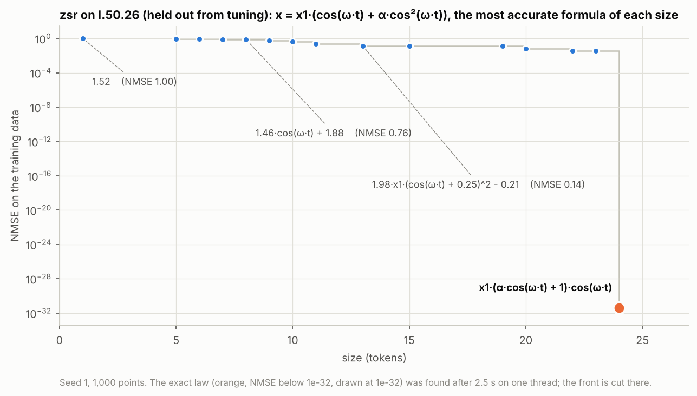
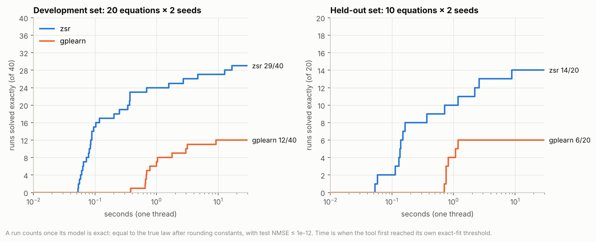
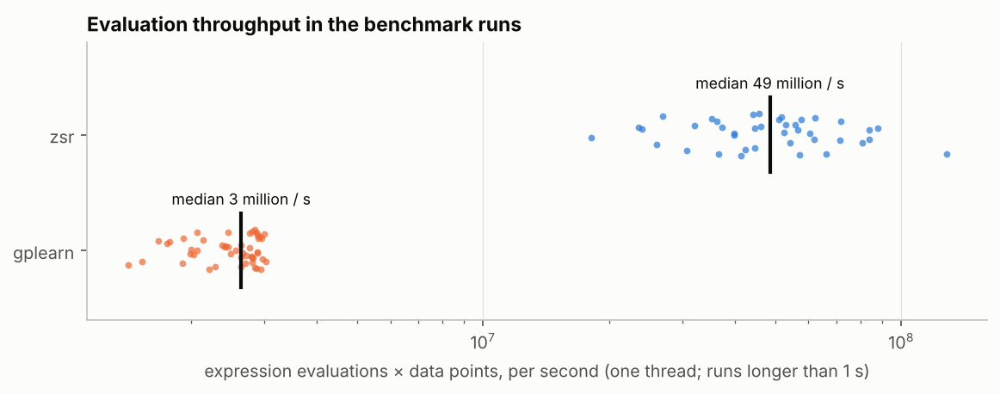
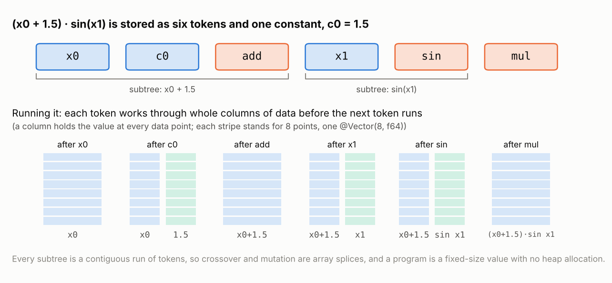

# zig-symreg

Symbolic regression in Zig: given a table of numbers, `zsr` searches for a formula that reproduces the last column from the others. It uses genetic programming, a population of formulas that evolve by crossover and mutation, and returns the most accurate formula of each size.

Its expressions are fixed-size arrays of tokens in reverse Polish notation, so a program is a plain value with no heap allocation, and crossover and mutation are array splices. It evaluates a formula on the whole data set one operator at a time, eight data points at a time. Each formula is judged by its best linear rescaling, so the search looks for the shape of a law and least squares supplies its scale. Constants are fitted by Levenberg–Marquardt. The whole program is one statically linked executable (705 KB stripped) with no run-time dependencies.

On 30 equations from the Feynman Lectures, with 30 seconds on one thread, it recovered the exact law in 43 of 60 runs; gplearn, under the same budget, did so in 18.



Each point is the most accurate formula zsr found of that size. The search first finds that the target oscillates with ω·t, then that it depends on the square of a shifted cosine, then the law itself, here written by SymPy as x1·(α·cos(ω·t) + 1)·cos(ω·t). This equation was not among those used to choose zsr's settings.

## Results

The benchmark has 30 equations from the Feynman Lectures on Physics, as catalogued by AI Feynman (Udrescu and Tegmark, 2020), with their variable ranges. Twenty, the **development set**, were used to choose zsr's settings. Ten, the **held-out set**, were picked before zsr ever ran on them and were not used for tuning. For each equation and seed (two seeds), both tools get 1,000 noise-free training points, 30 seconds on one thread, the operators + − × ÷ sin cos exp log √ x², and 1,000 programs per generation. Two runs went at a time on a 2-vCPU cloud VM (Intel Xeon, 2.1 GHz). A run counts as **exact** when SymPy finds its formula equal to the true law after each constant is rounded to a simple number (a ratio of integers up to 64, possibly with π, √π or √(2π)), and its predictions on 1,000 separate test points have NMSE ≤ 10⁻¹².

| Claim | Evidence | Grade |
|---|---|---|
| Recovers most laws exactly in 30 seconds | Development set: 29 of 40 runs exact, covering 17 of the 20 equations (12 in both seeds). Held-out set: 14 of 20 runs, covering 7 of the 10 equations, each in both seeds | measured, one machine |
| Recovers far more than gplearn under the same budget | gplearn 0.4.3: 12 of 40 runs on the development set and 6 of 20 on the held-out set. gplearn solved nothing zsr missed | measured, one machine |
| Reaches the exact law sooner | On the 18 runs both solved, zsr got there 11 times sooner (geometric mean; 3.7 to 46 times). Median time to the exact law: 0.09 s on the development set, 0.15 s on the held-out set | measured, one machine |
| Its inexact answers are closer | Where zsr missed, its formula's median test R² was 0.99999996 (worst 0.980). gplearn's misses had median test R² 0.953 | measured |
| Evaluates expressions 18 times faster | Median 49 million expression-point evaluations per second against gplearn's 2.6 million. The programs differ in size, and zsr's count includes constant fitting on 128 points | measured, one machine |
| The settings were not fitted to the benchmark alone | 70% of held-out runs exact, against 72.5% on the development set. Ten held-out equations and two seeds are a small sample | plausible |
| Exact results are reproducible | With a fixed number of generations a run is deterministic. CI recovers eight laws exactly and checks that each run repeats bit for bit | proven (runs in CI) |
| Fails on relativistic factors | m₀/√(1 − v²/c²) and its relatives (I.10.7, I.15.10, I.48.2) were never recovered in 6 runs. The formulas found have test R² above 0.9999999 but are series-like approximations, since v/c stays below 2/3. For E = mc²/√(1 − v²/c²), one run found mc² + ½mv² plus a correction term, the low-speed expansion, with test NMSE 5×10⁻¹³: a numerical test alone would have called it exact. I.18.4, I.16.6 and I.40.1 were also never recovered | measured |
| Compared with PySR | Not measured. PySR, the strongest widely used system, needs Julia packages that this machine cannot download, so it was not run | none |



Both tools solve the easy laws, products and ratios of variables, quickly. zsr's advantage is on laws with constants or nested structure. gplearn's constants are fixed random numbers that evolution can only combine arithmetically, so it cannot produce 1/(4π) or 1/√(2π) exactly, and the exactness test rejects near misses. zsr fits constants by least squares.



## How it works



### Representation

A formula is up to 40 tokens and 8 constants, stored in reverse Polish notation: `(x0 + 1.5) · sin(x1)` is `x0 c0 add x1 sin mul`, with c0 = 1.5. Every subtree is a contiguous run of tokens, found by walking back from its last token and counting arities, so the variation operators are splices of token arrays:

- **crossover** replaces a random subtree of one parent with a random subtree of another;
- **subtree mutation** replaces a random subtree with a new random tree;
- **insertion** puts a new operator above a random subtree s: op(s, r), op(r, s) or op(s), with r a new random tree;
- **point mutation** swaps one token for another of the same arity;
- **constant mutation** scales or shifts one constant;
- **hoisting** replaces the whole formula by one of its subtrees.

After each operation, subtrees made only of constants are folded into one constant.

### Evaluation

The evaluator runs one token at a time over every data point before moving to the next token. The stack holds whole columns of 1,000 values rather than single numbers, and each operator is a loop over `@Vector(8, f64)`. The interpreter's dispatch is paid once per token per data set instead of once per token per point. A formula whose output is not finite at any point gets an infinite loss.

### Linear scaling

The loss of a formula f is the normalised mean squared error (NMSE, the mean squared error divided by the variance of the target) of a + b·f, with a and b found in closed form by least squares (Keijzer, 2003). Two passes over f's output give a and b, and the error follows from the same sums. Near an exact fit those sums cancel, so there the residuals are added up directly. A coefficient within 10⁻¹² of 0, 1 or −1 is set to that value, so a formula that needs no rescaling is reported without one.

When a formula enters the hall of fame, its rescaling is written into it and counted in its size. If the formula already multiplies, divides or adds a constant at its root, the coefficient is merged into that constant. Otherwise `b mul` and `a add` are appended.

### Constants

Constants are fitted by Levenberg–Marquardt with a forward-difference Jacobian, jointly with a and b. Each fit uses the first 128 data points and at most 15 iterations, from the current constants and from a perturbed copy, and the result is kept only if it lowers the loss on all the data. This runs on 10% of new formulas and on every formula about to enter the hall of fame.

### Search

Four islands of 250 formulas each evolve separately. Each generation, an island builds a new population, keeping its best formula, by tournament selection among 6 formulas on the score ln(NMSE) + 0.03 × size. The hall of fame keeps the most accurate formula of each size across all islands. Every 50 generations, 5% of each island is replaced by members of the hall of fame's Pareto front.

The run stops at the time limit, or 30 generations after the first formula with NMSE ≤ 10⁻²⁰. From the Pareto front it reports the formula with the largest drop in log NMSE per extra token, among those within 1.5 times the best loss, as PySR does.

### How the settings were chosen

The settings came from two rounds of runs on the seven development equations that zsr first found hard (I.8.14, I.10.7, I.13.4, I.15.10, I.18.4, I.27.6, I.37.4). Each round used three search seeds (101 to 103), different from the benchmark's, and 30 seconds per run. All data are in `docs/data/tuning.json`.

| Settings | Exact runs (of 21) |
|---|---:|
| **Round 1.** Before tuning: linear scaling, parsimony 0.12, migration every 5 generations | 3 |
| … without linear scaling | 3 |
| … migration every 50 generations | 4 |
| … parsimony 0.03 | 5 |
| … migration every 50, parsimony 0.03 | 6 |
| … migration every 50, parsimony 0.03, without linear scaling | 4 |
| **Round 2.** Migration every 50, parsimony 0.03, rerun as a control | 6 |
| … with insertion mutations (10%) | **7, chosen** |
| … with parsimony 0.01, 0.03, 0.06 and 0.12 on the four islands | 5 |
| … with both | 3 |

Differences of one or two runs in 21 are within run-to-run noise. The clearest effect is parsimony on I.8.14, d = √((x₂ − x₁)² + (y₂ − y₁)²): 0 of 3 runs at 0.12, 3 of 3 at 0.03. A likely reason: with linear scaling, a formula such as (x₂ − x₁)² needs no added constant, so under strong parsimony the population loses the "+ c" terms that subtree mutation could replace with (y₂ − y₁)². On the target (x₂ − x₁)² + (y₂ − y₁)² alone, zsr at parsimony 0.12 was still stuck at (x₂ − x₁)² after 300 generations, and at 0.03 it found the sum in about 15. Insertion mutations add a second way to grow a sum. Linear scaling itself made little difference on these seven equations: 6 runs against 4 without it, at migration every 50 generations and parsimony 0.03.

## Limitations

- Noise-free data only; robustness to noise was not tested.
- At most 40 tokens, 8 constants and 16 variables per formula.
- The settings were tuned on the development set, so its results are optimistic. The held-out set, ten equations, is small.
- Two seeds per equation, a 30-second budget and one machine.
- gplearn is a weak baseline: it has no constant fitting or linear scaling, and its defaults fit mean absolute error. It is here because it runs in the same environment. PySR and Operon, which are much stronger, were not compared.
- The Pareto front can list a few larger formulas after the first exact one that differ from it only by rounding error.

## Reproduce

Needs Zig 0.17.1. The scripts need Python with numpy and sympy; the benchmark also needs gplearn 0.4.3 and scikit-learn.

```sh
zig build test                     # unit tests
zig build -Doptimize=ReleaseFast
python3 scripts/ci.py              # what CI runs: eight laws recovered exactly, deterministically
python3 scripts/tune.py --round 1  # the tuning runs (docs/data/tuning.json)
python3 scripts/tune.py --round 2
python3 scripts/bench.py           # zsr against gplearn (docs/data/bench.json)
python3 scripts/figures.py
```

To search your own data, write a CSV file whose first line names the columns and whose last column is the target:

```sh
./zig-out/bin/zsr data.csv --time 30 --ops add,sub,mul,div,sin,cos,exp,log,sqrt,square --json result.json
```

## License

Copyright (c) 2026 Ankit Pawar. All Rights Reserved.

This repository is public so that the work can be read and evaluated, but it is not open source. Using, copying, modifying, redistributing or commercially exploiting any part of it requires prior written permission. This does not affect what applicable law allows without permission, or viewing and forking the repository on GitHub under GitHub's Terms of Service. The full terms are in [LICENSE](LICENSE).

For licensing or collaboration, email ankitpawar0007x@gmail.com or visit [ankitinorbit.com](https://ankitinorbit.com).
